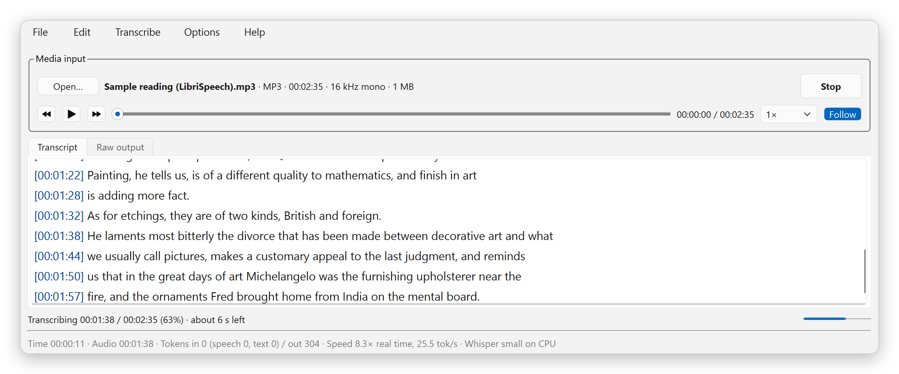
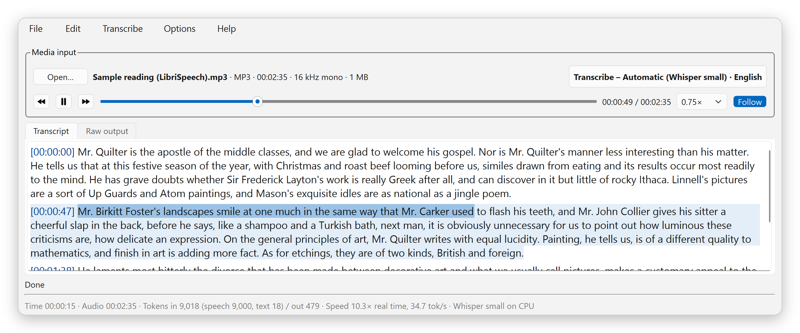
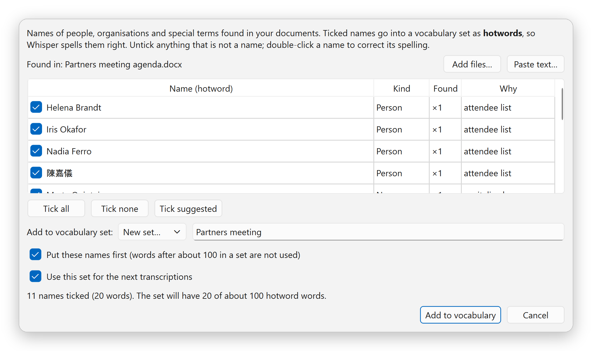

# Secure Offline Transcriber

**Turn recordings into time-stamped transcripts. Nothing leaves your PC. Install nothing.**

<p>
  <a href="https://github.com/hylhk23/SecureOfflineTranscriber/releases/latest"></a>
  
  
  <a href="https://buymeacoffee.com/flyingturtle"></a>
</p>

A speech-to-text program for Windows that turns recorded meetings, interviews and calls into time-stamped transcripts in **English, French, Cantonese and Mandarin**, using speech models that run on your own PC. Portable: unzip and run, no installation and no admin rights.

**[Download the latest version](https://github.com/hylhk23/SecureOfflineTranscriber/releases/latest)** · Windows 11 or 10, 64-bit · Free

<p align="center">
  
</p>

## What it does

Open a recording (WAV, MP3, M4A, MP4, MKV and most other audio and video files), press **Transcribe**, and the text appears as it is recognised, each line with its time. Check it against the audio with follow-along playback, correct names once so they are right in every file, and export it as text for your minutes, a Word document or subtitles. The speech models run on your PC; once they are downloaded, no internet connection is needed.

| | |
| --- | --- |
| **Private** | Audio and transcripts never leave your PC. No account, no cloud service, no telemetry |
| **English and three more languages** | English, French, Cantonese (also mixed with English) and Mandarin; Chinese in Traditional (Hong Kong or Taiwan) or Simplified characters |
| **Fast proofreading** | The sentence being played is highlighted; jump to lines the model was unsure about; replay a sentence; slow playback to 0.75× |
| **Resume long jobs** | Stop a long file, or survive a crash or power cut, and carry on where it stopped |
| **Names spelled right** | Takes the names from your agenda, attendee list or e-mail and gives them to Whisper as hotwords |
| **Ready for minutes and subtitles** | Text with times, plain text, Word, SRT and WebVTT subtitles, Markdown, JSON and CSV |
| **Portable** | Unzip and run `run.bat`. No installer, no admin rights |

> **Free, with no ads, no account and no subscription.** If Secure Offline Transcriber saves you an afternoon of typing up a recording, consider buying me a coffee. It keeps the project going.
>
> <a href="https://buymeacoffee.com/flyingturtle"></a>

---

## Why it suits the office

### Confidential recordings stay on your PC
Board meetings, HR interviews, client calls: many recordings should not be uploaded to an online transcription service. Secure Offline Transcriber runs open speech models (OpenAI Whisper, SenseVoiceSmall, NVIDIA Parakeet, Moonshine) on your own processor:
- the only internet connection it makes is the download of a model, when you click **Download**; models come from Hugging Face at a fixed version and every file is checked against its SHA-256 fingerprint;
- **Offline Mode** switches on by itself once a model is installed, and blocks every network call;
- there is no account, analytics, crash reporting or update server. Logs hold file names and timings, never transcript text;
- **Options > Advanced > Privacy check** lists every folder the program uses and confirms no network port is open.

### English, French, Cantonese and Mandarin
Choose the language, or let the program detect it. **Automatic** picks a suitable installed model for each language, for example Whisper large-v3-turbo or Parakeet for English and French, and SenseVoiceSmall for Cantonese (including Cantonese mixed with English) and Mandarin. Chinese text is written in Traditional (Hong Kong or Taiwan) or Simplified characters, as you prefer. How accurate a transcript is depends on the recording: clear audio from a nearby microphone gives the best results.

### Check a transcript in a fraction of the time
Checking a transcript against the recording is usually the slowest part of the work, so the player and the text work together:
- while the audio plays, the paragraph is tinted and the sentence being spoken is highlighted, and the text scrolls with it;
- **F6** plays the current sentence again, **F7** / **F8** jump to the lines Whisper was unsure about (tinted amber), **F9** plays or pauses even while you type;
- **Ctrl**+click any word to hear its sentence; playback runs at 0.5× to 1.5× with natural pitch;
- correct the text in place; **Replace** fixes a misheard name in the whole transcript, and **Add Selection to Vocabulary** fixes it in future files too.

<p align="center">
  
</p>

### Names from your meeting papers
Speech models misspell names they have never heard. Open the agenda, attendee list or e-mail for the meeting (Word, Excel, PDF with text, plain text or a saved e-mail) and the program lists the people, organisations and special terms in it. Untick anything that is not a name, and the rest go into a vocabulary set as **hotwords** for Whisper. Names are found with simple rules on your PC, not by an online service, so check the suggestions.

<p align="center">
  
</p>

### Long recordings: resume and queue
Stop a long transcription when you need the PC and press **Resume** later: it carries on from where it stopped, with the same model and language, and keeps any corrections you made in the meantime. The text is also saved every few seconds while a job runs, so after a crash or power cut the program offers to resume. Several files can be queued and are saved one by one.

### No installation, no admin rights
It is a portable application. Copy the folder to any location you can write to (your Documents, a D: drive, a USB stick) and double-click `run.bat`. Nothing is installed and **no administrator rights are needed**, so it works on a managed work PC where you cannot install software. Settings, logs and downloaded models stay inside the program folder. To remove it, delete the folder.

### Unlikely to trigger antivirus false alarms
Python programs packed into an `.exe` with tools such as PyInstaller are sometimes flagged by antivirus engines. Secure Offline Transcriber avoids that packing:
- the package contains three programs: `python.exe` and `pythonw.exe`, the official Python 3.13 interpreter from python.org, **digitally signed by the Python Software Foundation**, and `ffmpeg.exe`, the unmodified FFmpeg build from gyan.dev that reads audio and video files (FFmpeg builds are not signed; its source and checksum are listed in `ffmpeg\SOURCE.txt`);
- everything else is plain Python source code (`.py`), which you can read, and standard library files (`.pyd`, `.dll`) from python.org and the Python Package Index;
- `verify-files.bat` checks every file against the list of checksums shipped with the package.

### Other useful features
- Model manager: download, pause and resume models; use models kept on another drive, a NAS or a USB stick; move models to a PC without internet as a model pack.
- New and updated models arrive as a small model-list file you import; installed models keep working.
- Vocabulary sets per event or client, with replacements that fix spellings for every model.
- Noise reduction for café or conference-floor recordings, with a preview in the player.
- Clickable times in the transcript, a statistics bar (speed, model, audio length), and settings you can export and share with colleagues.
- Full help with every menu item and setting explained: press **F1**.

> Transcribe conversations only with the participants' knowledge and in line with your organization's policies and local law. Check transcripts against the recording before relying on them.

---

## How it works

The program runs as two processes on your PC. The window you work in never does the heavy work: each transcription is handed to a separate worker process, so the window stays responsive, and if a model fails, the text already made is kept.

<p align="center">
  <picture>
    <source media="(prefers-color-scheme: dark)" srcset="docs/images/architecture-dark.png">
    
  </picture>
</p>

**From recording to transcript**

1. **Open a recording.** `ffmpeg.exe` reads the file's header to show its format, length and audio tracks.
2. **Transcribe.** The window sends the job to the worker: the file and audio track, the language, the model, your vocabulary and settings, and where to start (the beginning, or the point where a stopped job ended).
3. **Decode.** The worker has `ffmpeg.exe` convert the audio to 16 kHz mono, 30 minutes at a time, so even a three-hour recording does not fill the memory. Noise reduction, if switched on, is applied here.
4. **Find speech.** The volume is evened out, and Silero voice detection cuts the audio into pieces of speech of up to 15 seconds. Silence never reaches the model, which is the main protection against invented text.
5. **Choose the model.** With the language on Auto-detect, a language check runs on the first 15 minutes. With the model on Automatic, the first installed model in that language's order is used: Whisper large-v3-turbo (then Parakeet) for English and French, SenseVoiceSmall for Cantonese and Mandarin. The model loads once and stays loaded for the next file.
6. **Recognise.** The model turns each piece into text on the CPU; Whisper also gets the names in your vocabulary set as hotwords. Each finished piece goes straight back to the window, so the text appears line by line with its time, while the progress bar and statistics update about once a second.
7. **Keep the work safe.** While the job runs, the text so far is saved to `data\jobs` every 10 pieces or 3 seconds. After Stop, a crash or a power cut, **Resume** carries on from the end of that text.
8. **Clean up and save.** When the job ends, the window removes known invented phrases and runaway repeats, applies your replacements, converts Chinese to the characters you chose and builds paragraphs. The transcript and your chosen formats are saved to `Documents\SOT Transcripts`.

**Proofreading.** The player is part of the window: `ffmpeg.exe` streams the recording to your speakers through sounddevice, at 0.5× to 1.5× speed with natural pitch, and the transcript editor uses the playback time to highlight the sentence being spoken.

**Names from documents.** The agenda, attendee list or e-mail you open is read on your PC, and simple rules pick out the names. You check them before they go into a vocabulary set.

**The only network connection.** The model manager downloads model files from Hugging Face when you click **Download**, at a fixed version, and checks every file against its SHA-256 fingerprint. No audio or text is ever sent. Once a model is installed, Offline Mode switches on and blocks even that.

---

## Install

You need Windows 11 or 10 (64-bit). The download is a zip file of about 150 MB (420 MB once extracted). At the first start the program downloads the speech models you choose: the recommended set is about 0.7 GB, or 1.9 GB on a PC with 12 GB of memory or more (internet needed once).

### Option 1: manual download

1. Open the **[latest release](https://github.com/hylhk23/SecureOfflineTranscriber/releases/latest)** and click **`SecureOfflineTranscriber-portable-win64.zip`** under *Assets*.
2. In File Explorer, right-click the downloaded zip, choose **Properties**, tick **Unblock** at the bottom (if shown) and click **OK**. This stops Windows from showing security warnings for files that came from the internet.
3. Right-click the zip and choose **Extract All...**, pick a folder you can write to (for example `C:\Users\<you>\Apps`) and click **Extract**. Inside it you get a folder named `SecureOfflineTranscriber`. (Windows may add a folder named after the zip around it; that is fine.)
4. Optional: double-click **`verify-files.bat`** in that folder. It checks that every file arrived complete (antivirus programs sometimes block a file while unzipping).
5. Double-click **`run.bat`**.
6. Optional: double-click **`create-shortcut.bat`** to add Secure Offline Transcriber to your Desktop and Start menu. Run it again if you move the folder.

### Option 2: command line

Open **Command Prompt** or **PowerShell** and run these lines. They use `curl` and `tar`, which are built into Windows 10 and 11, and save the program to `C:\Users\<you>\SecureOfflineTranscriber`.

```bat
cd %USERPROFILE%
curl.exe -L -o SecureOfflineTranscriber-portable-win64.zip https://github.com/hylhk23/SecureOfflineTranscriber/releases/latest/download/SecureOfflineTranscriber-portable-win64.zip
tar -xf SecureOfflineTranscriber-portable-win64.zip
SecureOfflineTranscriber\run.bat
```

In PowerShell, replace the first line with `cd $env:USERPROFILE` and the last line with `.\SecureOfflineTranscriber\run.bat`.

To add the Desktop and Start-menu shortcuts from the command line: `SecureOfflineTranscriber\create-shortcut.bat`

**Check the download (optional).** Compare the SHA-256 value with the one listed on the release page:

```bat
certutil -hashfile SecureOfflineTranscriber-portable-win64.zip SHA256
```

### First use

1. At the first start, choose **Download recommended set** (or **Add a model folder** if you already keep Whisper or SenseVoice models somewhere).
2. Open a recording with **Open...** or by dropping it on the window. The **Transcribe** button shows which model and language will be used.
3. Press **Transcribe** (F5). The transcript and your chosen formats (text with times and SRT subtitles, by default) are saved to `Documents\SOT Transcripts`.
4. Proofread with **F9** (play/pause), **F6** (replay the sentence) and **F8** (next unsure line), then **File > Export** for Word or other formats.

Full help: press **F1** in the app, or open [`app/docs/HELP.html`](app/docs/HELP.html).

### Update to a new version
Download and extract the new zip. Before deleting the old folder, copy its **`data`** folder (settings and vocabulary) and **`models`** folder (downloaded models) into the new `SecureOfflineTranscriber` folder, replacing the empty ones. Transcripts in `Documents\SOT Transcripts` are not affected.

### Remove
Close the app. If you registered it under **Options > Advanced > File types**, click **Unregister** first. Run `create-shortcut.bat /remove` if you created shortcuts, then delete the `SecureOfflineTranscriber` folder. Your transcripts stay in `Documents\SOT Transcripts`. (Only if the program folder was read-only were settings kept in `%LOCALAPPDATA%\SecureOfflineTranscriber`; delete that too.)

---

## Troubleshooting

| Problem | What to do |
| --- | --- |
| "Windows protected your PC" or a security warning when running `run.bat` | This is Microsoft Defender SmartScreen, the Windows check on files downloaded from the internet. Unblock the zip (Option 1, step 2) and extract it again. |
| "Some program files are missing" at start | The zip was not fully extracted, often because antivirus blocked a file. Delete the folder, extract again (7-Zip is the most reliable) and run `verify-files.bat`. **Windows Security > Protection history** shows any file it blocked. |
| `run.bat` does nothing, or asks for Python | Make sure the `python` folder is inside `SecureOfflineTranscriber`. Download the **portable** zip from Releases, not *Code > Download ZIP* (that is the source code only). `run-debug.bat` shows what goes wrong. |
| Model download fails at work | The network may block Hugging Face. Try **Options > Advanced > Proxy**, or download the models on another PC and use **Export model pack** / **Import model pack**. Offline Mode must be off to download. |
| Names come out wrong | Use a Whisper model and add the names as hotwords (**Edit > Add Names from Documents**), or add replacements in **Options > Vocabulary**. |
| Transcription is slow | Use SenseVoiceSmall or Parakeet, keep Speed on **Fast**, and stop other heavy programs. You can **Stop** and **Resume** later. |
| Your organization blocks programs in your user folders | Some IT policies only allow programs in approved locations. Ask your IT team. |

---

## For developers

The repository holds the Python source code. The portable zip on the Releases page adds the Python runtime, the libraries and `ffmpeg.exe`.

```bat
git clone https://github.com/hylhk23/SecureOfflineTranscriber.git
cd SecureOfflineTranscriber
py -3.13 -m venv .venv
.venv\Scripts\pip install -r build\requirements.txt
rem put ffmpeg.exe in a folder named "ffmpeg" here, or on your PATH
.venv\Scripts\python app\OfflineTranscriber.py
```

Build the portable zip with `build\build.bat`; run the tests with `python -m pytest tests`. Project layout, architecture, the build and the model list: [`docs/DEVELOPER.md`](docs/DEVELOPER.md).

---

## Support the project

Secure Offline Transcriber is built and maintained by one developer in spare time, and it will stay free: no ads, no account, no data collection. If it saves you time on meeting minutes or interview notes, a coffee is a simple way to say thanks and helps pay for the time that goes into new features and fixes.

<p align="center">
  <a href="https://buymeacoffee.com/flyingturtle"></a>
  <br>
  <a href="https://buymeacoffee.com/flyingturtle">buymeacoffee.com/flyingturtle</a>
</p>

**Other ways to help, at no cost:**
- Click **Star** at the top of this page, so other people can find the app.
- Share it with colleagues who transcribe meetings or interviews.
- Report a problem or suggest a feature under **Issues**.

## Licence

Copyright © 2026 Neo Time Consulting. Free to download and use; see [LICENSE](LICENSE). Bundled third-party software keeps its own licences, and speech models are downloaded under their owners' licences; see [THIRD-PARTY-LICENSES.txt](THIRD-PARTY-LICENSES.txt). Screenshots use a sample from the LibriSpeech corpus (CC BY 4.0).
